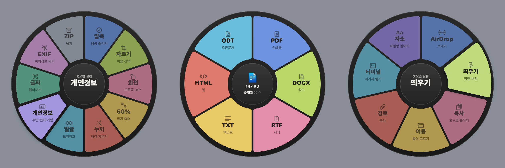

# 빙글변환

파일을 끄는 도중 키를 한 번 누르면 커서 주변에 휠이 뜨고, 원하는 칸에 놓으면 같은 폴더에 결과 파일이 생기는 파일 변환 앱. 맥과 윈도 지원, 모든 처리는 내 컴퓨터 안에서 끝남.

## 내려받기

[Releases](https://github.com/highwindhawk/bingle-convert/releases/latest)에서 운영체제에 맞는 파일을 받음.

| 운영체제 | 파일 | 조건 |
|---|---|---|
| macOS | `BingleConvert-1.1-mac.dmg` | macOS 13 이상, 애플 실리콘·인텔 |
| Windows | `BingleConvert-1.0.0-windows-x64.zip` (시험판) | Windows 10 2004 이상, x64 |

## 쓰는 법

| 키 (맥 / 윈도) | 휠 |
|---|---|
| ⇧ / Shift | 변환: 이미지·영상·오디오·한글 문서·PDF 형식 바꾸기 |
| ⌘ / Ctrl | 도구: 압축, 회전, 개인정보 가리기, 글자 추출, PDF 합치기·낱장·10MB 맞추기, ZIP 등 |
| ⌃ / Alt | 동작: 복사, 이동, 경로 복사, 터미널 열기 등 |

파일을 끄는 중 키를 한 번 누르고, 원하는 칸 위에 놓으면 끝. 가운데 원이나 휠 밖에 놓으면 취소.

## 한국 업무용 기능

- 한글 문서 HWP·HWPX → PDF(맥)·DOCX·TXT·HTML, 문단과 표 유지
- 사진 속 주민등록번호·전화번호·계좌번호 자동 가리기
- 사진 속 글자 추출 (한국어 OCR)
- 맥에서 만든 한글 파일명이 윈도에서 자모로 풀려 보이는 문제 정리 (맥)
- 윈도에서도 한글 파일명이 깨지지 않는 ZIP
- 관공서 업로드용 PDF 10MB 맞추기

## 설치

**맥**: DMG를 열어 빙글변환을 Applications로 옮김. 아직 Apple 공증 전이라 처음 실행 시 차단되면 Applications에서 **우클릭 → 열기**, 그래도 막히면 시스템 설정 > 개인정보 보호 및 보안 > **그래도 열기**. 메뉴바에 돌림판 아이콘이 생기면 준비 완료.

**윈도**: zip을 풀고 `BingleConvert.exe` 실행. 코드 서명 전이라 SmartScreen 경고가 뜨면 **추가 정보 → 실행**. 작업 표시줄 오른쪽 트레이에 아이콘이 생기면 준비 완료.

영상 형식을 더 쓰려면(선택) 맥은 `brew install ffmpeg`, 윈도는 `winget install Gyan.FFmpeg`.

## 개인정보

파일을 어디에도 올리지 않음. 변환·글자 인식·개인정보 가리기 모두 운영체제 내장 기능으로 내 컴퓨터에서 처리.

## 알려진 제한

- 맥판은 Apple 공증 전, 윈도판은 코드 서명 전이라 첫 실행 시 보안 경고가 뜸
- 윈도판은 시험판으로, 문제를 발견하면 [Issues](https://github.com/highwindhawk/bingle-convert/issues)에 남겨 주면 됨
- HWP 변환은 문단과 표만 옮기며 그림·글꼴·암호·배포용 문서는 미지원
- 개인정보 가리기는 글자 인식에 의존하므로 보내기 전 결과를 꼭 눈으로 확인

## 이용 조건

개인·업무 용도로 무료 사용 가능. 무단 수정·재판매 금지.
